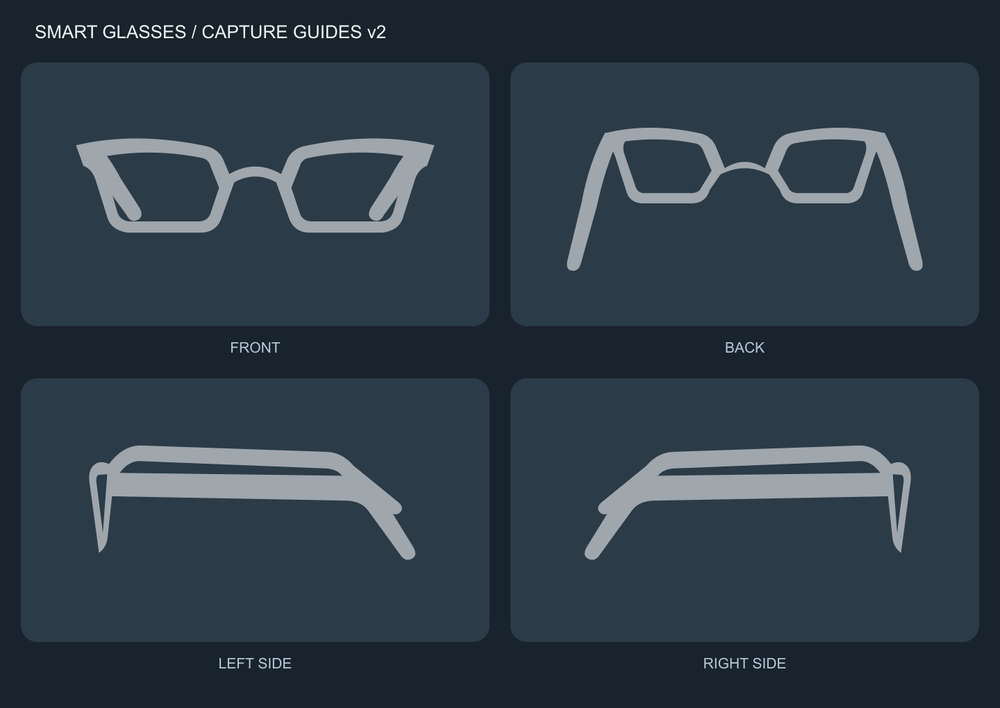
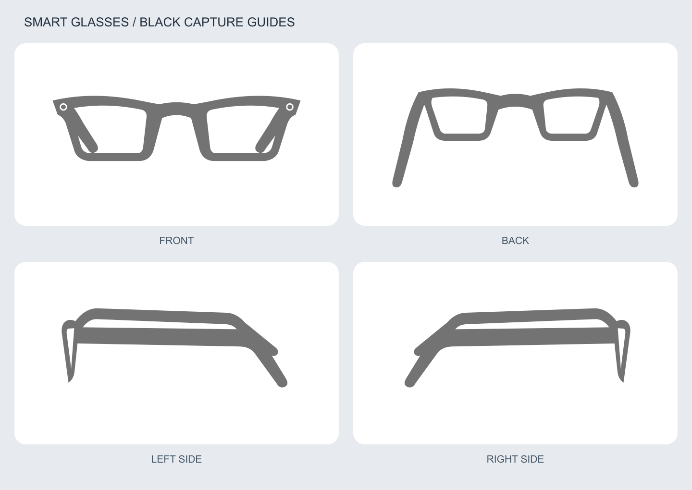

# Smart glasses capture guide assets

Transparent, semi-transparent white silhouettes for a mobile camera capture placeholder. Four matching views: front, back (wearer side, with both temples unfolded), left side, and right side. All temples are filled surfaces; the rear temples connect to the upper outer corners of the rims.

Matching black variants are also available below, with circular camera marks at both outer front corners.



## Direct image URLs

Use the PNG URLs when a development platform needs ordinary image assets. These URLs point directly to images, not GitHub file preview pages.

| View | PNG | Editable SVG |
| --- | --- | --- |
| Front | [glasses-front.png](https://raw.githubusercontent.com/kommiter/smart-glasses-capture-assets/main/assets/glasses-front.png) | [glasses-front.svg](https://raw.githubusercontent.com/kommiter/smart-glasses-capture-assets/main/assets/glasses-front.svg) |
| Left side | [glasses-left-side.png](https://raw.githubusercontent.com/kommiter/smart-glasses-capture-assets/main/assets/glasses-left-side.png) | [glasses-left-side.svg](https://raw.githubusercontent.com/kommiter/smart-glasses-capture-assets/main/assets/glasses-left-side.svg) |
| Right side | [glasses-right-side.png](https://raw.githubusercontent.com/kommiter/smart-glasses-capture-assets/main/assets/glasses-right-side.png) | [glasses-right-side.svg](https://raw.githubusercontent.com/kommiter/smart-glasses-capture-assets/main/assets/glasses-right-side.svg) |
| Back | [glasses-back.png](https://raw.githubusercontent.com/kommiter/smart-glasses-capture-assets/main/assets/glasses-back.png) | [glasses-back.svg](https://raw.githubusercontent.com/kommiter/smart-glasses-capture-assets/main/assets/glasses-back.svg) |

[Machine-readable asset manifest](https://raw.githubusercontent.com/kommiter/smart-glasses-capture-assets/main/manifest.json)

Left and right refer to the wearer. In the left-side image the front of the glasses points left; in the right-side image it points right. The two generic silhouettes are mirrored. The existing `glasses-side.png` and `.svg` URLs remain available as aliases of the updated left-side view.

## Black variants



| View | PNG | Editable SVG |
| --- | --- | --- |
| Front | [glasses-front-black.png](https://raw.githubusercontent.com/kommiter/smart-glasses-capture-assets/main/assets/glasses-front-black.png) | [glasses-front-black.svg](https://raw.githubusercontent.com/kommiter/smart-glasses-capture-assets/main/assets/glasses-front-black.svg) |
| Back | [glasses-back-black.png](https://raw.githubusercontent.com/kommiter/smart-glasses-capture-assets/main/assets/glasses-back-black.png) | [glasses-back-black.svg](https://raw.githubusercontent.com/kommiter/smart-glasses-capture-assets/main/assets/glasses-back-black.svg) |
| Left side | [glasses-left-side-black.png](https://raw.githubusercontent.com/kommiter/smart-glasses-capture-assets/main/assets/glasses-left-side-black.png) | [glasses-left-side-black.svg](https://raw.githubusercontent.com/kommiter/smart-glasses-capture-assets/main/assets/glasses-left-side-black.svg) |
| Right side | [glasses-right-side-black.png](https://raw.githubusercontent.com/kommiter/smart-glasses-capture-assets/main/assets/glasses-right-side-black.png) | [glasses-right-side-black.svg](https://raw.githubusercontent.com/kommiter/smart-glasses-capture-assets/main/assets/glasses-right-side-black.svg) |

The black artwork uses RGB #000000 at 55% opacity, so it appears gray over a white background. Both circular camera marks are on the front view; transparent rings separate each black lens center from the black frame. Camera marks are generic design cues. All background and lens openings remain transparent. Use `opacity: 1` when placing these assets.

## Integration

- All images use a 960 × 600 canvas with a transparent background.
- White and black guide artwork already has 55% opacity baked in. Use CSS opacity 1; do not apply 0.3 again.
- Place the image in the center of the existing camera capture area, at approximately 80% of its width.
- Use `object-fit: contain`, `pointer-events: none`, and an empty `alt` for this decorative guide. Provide the capture instruction separately as accessible text.
- Switch the asset URL to match the current front, back, left-side, or right-side capture step.
- No background removal, image generation, recoloring, or built-in placeholder is required.
- `preview.png` and `preview-black.png` demonstrate the assets on dark and light backgrounds. They are not transparent overlays and must not be used as the capture guide.

```html

```

The containing capture area should have `position: relative`. The host application owns the border, camera feed, instructions, and controls.

## Scope

These are newly drawn generic SVG guides, rasterized to PNG. They contain no product photographs, brand logos, or app screenshots. They are visual positioning aids, not evidence that a particular device is permitted or prohibited.

The raw URLs can be fetched directly. Search-engine indexing is separate and is not guaranteed; supply this README URL or the direct asset URLs to the development agent.
